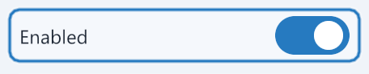

# Control borders, switch curves and item rotation centers

Windows validation on 2026-10-14.

## Confirmed rendering causes

Buttons and numeric fields drew their keyboard focus outline on the outer
widget bounds. Nuklear strokes extend to both sides of their path, so controls
against a panel's content clip lost part of the left border. The shaped Unicode
field also drew its own ordinary border on the outer bounds.

The new hidden native rendering check measured the focused button's left/right
accent coverage at 1,608/3,216 before the fix. Moving the focus stroke inward
restored equal coverage for buttons, switches and numeric fields, while the
shaped field still failed at 2,880/5,856. The shared inset border helper fixes
ordinary borders and focus outlines without expanding the content clip.
Numeric fields retain their original text padding when Nuklear's own stroke
is suppressed.

The switch track used Nuklear's fixed twelve-point rounded rectangle path,
which gives only three straight segments per quarter-circle. Its shape
antialiasing fringe was measured in logical units and widened at larger display
scales. The track and thumb now use analytic capsule/circle coverage in the
existing GL shader, with derivatives setting the edge transition to one
physical pixel. Drawing remains ordered with the surrounding Nuklear commands
and does not allocate switch textures.

The rendered regression compares track and thumb pixels against supersampled
capsule/circle coverage at 100%, 150% and 200%. The original track had a maximum
coverage error of 0.414 at 100%. The fixed track and thumb stay below 0.057 at
all three scales. Focused button, switch, numeric field and Unicode field
left/right border coverage is equal at every tested scale.



## Rotation behavior

Text, emoji and image items expose Rotation center under Appearance. Sprite
center is the default. Mouse position keeps the point under the wheel event's
cursor fixed throughout the eased circular path. A subsequent wheel event can
choose a new cursor pivot without a position jump, while wheel bursts retain
the accumulated target angle.

The choice belongs to the immutable item snapshot. Editing an item affects
future pulls; existing sprites retain their choice. Replacement adopts the
replacement item's choice. Changing the choice reuses the existing artwork.
Project packages omit the default value and save mouse rotation as
`"rotation_center":"mouse"`. Missing fields and explicit `"sprite"` load as
sprite-center rotation. Unknown strings and non-string values are rejected.

Runtime regressions cover intermediate/final rotation poses, repeated wheel
input, changing pivots, snapshot isolation, replacement, held-press dragging,
overlapping rotation and Alt+wheel resizing, zero easing and mixed display
densities. Review exposed a density-crossing bug: an active orbit translated
when a drag crossed from 100% to 200% but retained its previous desktop size.
A new regression failed before the correction. The remaining orbit now scales
with the destination display, including its pivot and offset, so the grabbed
point remains at the cursor during the rest of the animation.
The regression also queues another move on the destination display and crosses
back and forth before the next rendered frame, which verifies that the previous
display identity determines each scale transition.

## Verification

- The full Windows Debug build passed.
- Debug CTest excluding desktop-input tests passed 45 of 45 tests in 204.85
  seconds. This includes the new rendered borders/switch check, rotation-center
  editor check, runtime tests and project storage/validation.
- After the final density-crossing correction, all six affected runtime,
  interaction and anchor-presenter tests passed in 32.46 seconds, including
  the compatibility presentation route.
- The final queued-crossing checks passed in both the direct and compatibility
  runtime executables.
- The hidden Settings editor suite passed ordinary, minimum and narrow layouts
  at controlled 100%, 150% and 200% scales.
- The complete hidden Settings rendering suite passed, including input/draft
  commits, dropdowns, disabled controls, chooser callbacks, Unicode editing,
  close/reopen and project roundtrips.
- The Windows Release application build passed.
- Debug and Release `Yoink.exe --smoke-test` each exited with code 0.
- `git diff --check` passed. The independent review's density-crossing finding
  was reproduced and corrected.

Build and test logs are in `build/borders-rotation-*.log`. Native rendering used
hidden Windows SDL/OpenGL windows and normalized events. This run does not
verify macOS, full desktop input injection or physical monitor changes.

```powershell
cmake --build --preset windows-dev --parallel 6
ctest --preset windows-dev -LE desktop --output-on-failure
build/windows-dev/Debug/pointy_control_borders_test.exe
build/windows-dev/Debug/pointy_runtime_test.exe --rotation-centers
build/windows-dev/Debug/pointy_settings_smoke.exe --rotation-center-only
build/windows-dev/Debug/pointy_settings_smoke.exe --editor-only
build/windows-dev/Debug/pointy_settings_smoke.exe --render-only
cmake --build --preset windows-release --target PointyPointer --parallel 6
git diff --check
```
