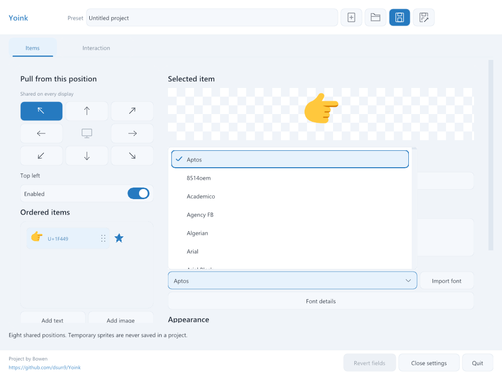
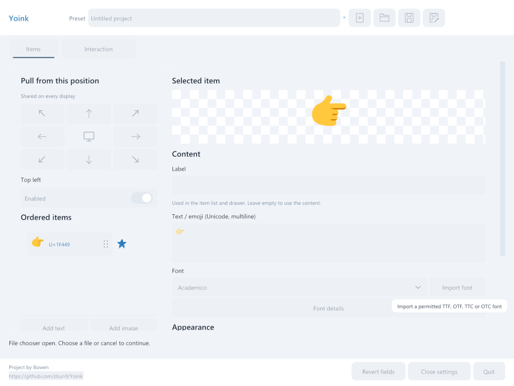

# Dropdown controls and field commits

Windows validation on 2026-10-13, on `main` based on `af8df99`.

## Confirmed causes

The shared button, switch and edit helpers treated an open dropdown as a
reason to disable every control outside the popup. The choice also used a
modal popup. Opening the installed-font list therefore changed unrelated
controls' enabled state and appearance. The new rendered regression failed
with `Save enabled=0` before the fix.

Disabled edits used Nuklear's global widget-disable styling, which multiplies
the brightness of several widget styles. This produced dark field fills. The
helpers now save and restore the local disabled state and use explicit fill,
border and ink colors. Shaped text uses reduced texture opacity when disabled.

Numeric edits validated and applied every intermediate value while typing.
That changed preview and error layout while the field was active. A regression
typed `1`, then `2`, and failed because the project value changed after the
first digit. Numeric and appearance edits now retain drafts until Enter or
blur. Pending corrections also pass through validation before a project
action, so correcting an error and clicking another item works in one click.

A further regression clicked a font-collection option covering the Font
details disclosure. The option selected correctly, but the same mouse release
moved focus to the disclosure after the popup closed. Consuming the release
after selection keeps focus on the dropdown trigger and prevents the click
from reaching controls beneath the list.

## Resulting behavior

- Both font selectors use an anchored, scrollable list with left-aligned
  options and a checkmark on the current choice. The list opens above or below
  its trigger according to available space.
- Escape dismisses the list and restores trigger focus. Tab and Shift+Tab
  leave the list. Outside clicks dismiss it and reach the clicked control.
- Surrounding controls retain their enabled state while a dropdown is open.
  The option layer owns clicks within the list.
- Disabled controls use fill `#EDF1F6`, border `#E2E8EF` and ink `#86919F`.
  Native dialogs and modal confirmations retain their existing input guards.
- Size, angle, opacity, color, collection index and Interaction numeric fields
  apply on Enter, clicking away, Tab or window focus loss. Invalid committed
  input retains its draft and the last valid project value.
- Project names, item labels and multiline content retain their live editing
  behavior. Selecting a dropdown option applies immediately.

## Verification

The new `settings_dropdown` and `settings_field_commit` checks use the actual
hidden native renderer and normalized platform events. They cover dropdown
selection and dismissal, enabled-state preservation, disabled-field input
guards, draft retention, focus retention and error correction before item
selection. Dropdown and disabled-style captures use controlled 100%, 150%
and 200% scales.

The native editor suite passed after the release-consumption fix. It includes
font-collection validation and disclosure guards, Unicode and fallback
feedback, error recovery, project roundtrips and ordinary/minimum/narrow
layouts at 100%, 150% and 200% controlled scales.

The full Windows Debug build passed. The Windows Debug CTest suite excluding
desktop tests passed 43 of 43 checks in 156.15 seconds. It includes both new
regressions, the existing item-control and popup-spacing checks, input events,
runtime behavior and storage. Logs are in `build/dropdown-final-build.log`,
`build/dropdown-final-core-tests.log` and `build/dropdown-editor-tests.log`.

The complete hidden Settings suite passed with `--render-only`, including
corrected drafts before Save and item mutations, both Settings pages,
composition and modal guards, controlled chooser callbacks, reorder gestures,
Unicode editing, close/reopen and project roundtrips. Its log is
`build/dropdown-final-render-tests.log`.

The rebuilt Debug application's `--smoke-test` completed with exit code 0.
The process was launched with isolated preferences, waited for explicitly and
captured in `build/dropdown-final-app-smoke.log`. `git diff --check` passed and
temporary diagnostic logs were removed. The follow-up code review found no
remaining actionable issues.

```powershell
cmake --build --preset windows-dev --parallel 6
ctest --preset windows-dev -LE desktop --output-on-failure
build/windows-dev/Debug/pointy_settings_smoke.exe --editor-only
build/windows-dev/Debug/pointy_settings_smoke.exe --render-only
Start-Process build/windows-dev/Debug/Yoink.exe -ArgumentList '--smoke-test' -WindowStyle Hidden -Wait -PassThru
git diff --check
```

The captures use hidden Windows SDL/OpenGL windows. This run does not verify
full desktop input injection, macOS or physical mixed-monitor density changes.




