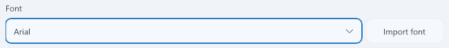
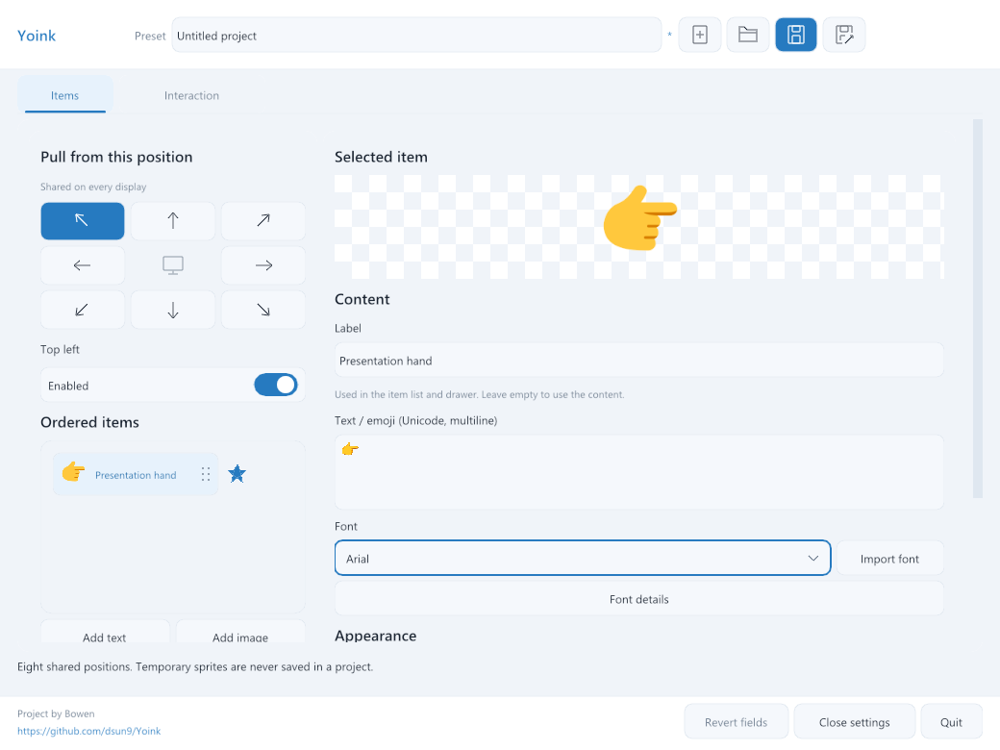
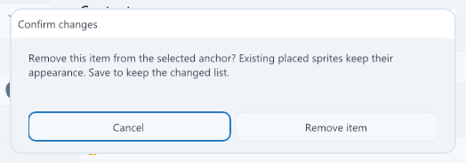
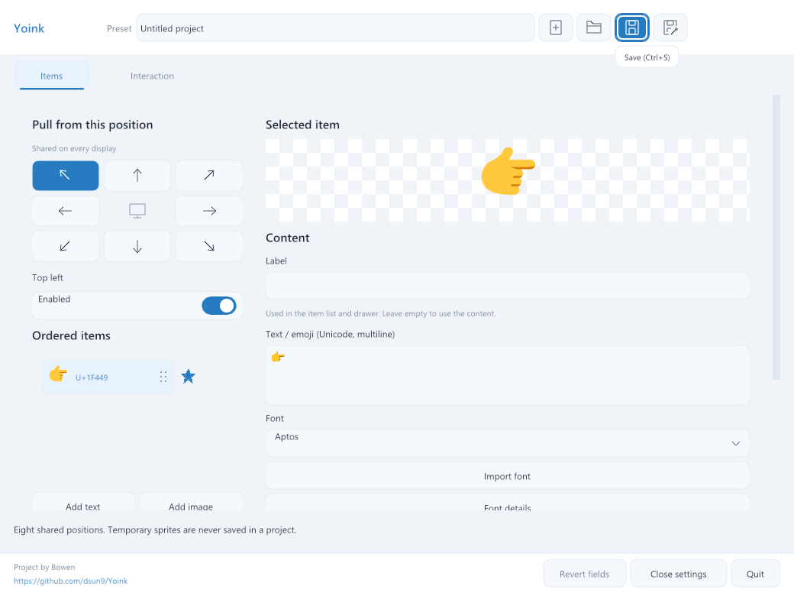

# Post-PR #28 regression fixes

Validated on Windows on 2026-10-13 against the working tree based on `167ddbe`.
The reported problems were reproduced with failing tests before applying the
fixes. The checks exercise the native Settings renderer, anchor presenter,
replacement drawer, and project storage.

| Reported problem | Confirmed cause | Corrected behavior |
| --- | --- | --- |
| Empty bottom space in tooltips | A minimum popup height and trailing line spacing exceeded the text height. | A single line with a 14-unit font uses a 28-unit popup, with 7 units of padding above and below, instead of 36 units. |
| Empty bottom space in item deletion confirmation | The fixed dialog height reserved an empty status row. | The dialog computes its height from its header, message, buttons, and padding. Space below the buttons is 14 units instead of 72. A nonempty status message still gets its own row. |
| Missing font dropdown | Only fonts with multiple collection faces offered a dropdown. | Text items always offer a sorted installed-font family picker. Font import and collection-face selection remain available. Selecting Arial through keyboard input updates the item. |
| Read-only Full label control | The editor offered disclosure and paging for a label derived from content. | An editable Label field names image and text items in both the Settings list and replacement drawer. Empty or whitespace-only labels use the content description. |
| Incorrect height for `👉👉aaaaaaa` at a corner | Placement reserved a square based on the item's longest side. | The presenter supplies the rotated rectangular extents. The reproduced item uses 630 by 122 units instead of 630 by 630, so its preview aligns with the screen corner. |

Custom labels are optional, limited to 1024 UTF-8 bytes, and saved in project
packages. Existing packages without labels still load. Snapshot ownership keeps
labels valid when artwork is reused. Changing a label does not regenerate the
artwork. The drawer fits custom labels at complete UTF-8 boundaries.

The corner correction changes placement bounds. The text renderer retains its
font line metrics and transparent padding. Existing rotation, dragging,
mixed-density display, bitmap, SVG, and GIF anchor checks pass.

The Windows font picker uses installed font families and imports the selected
font into project assets after checking editable embedding permissions. Family
matching accepts both canonical names and family/style aliases. A CoreText
enumeration implementation is included for macOS, but this Windows run did not
build or test it.

Validation completed with exit code 0:

| Check | Result |
| --- | --- |
| Full Windows Debug build and final affected-target rebuild | Passed |
| Windows Debug suite excluding desktop tests | 41 of 41 passed, 162.25 seconds |
| Complete hidden native Settings check with `--render-only` | Passed, including ordinary/minimum/narrow layouts, 100/150/200% controlled scaling, queued edits, Save/New, close/reopen, and modal handling |
| Release application and regression-target build | Passed |
| Targeted Windows Release tests | 6 of 6 passed, 50.26 seconds |
| Patch whitespace check | `git diff --check` passed |

Before pushing the complete fixes to main, the final Windows Debug suite
excluding desktop tests passed again, 41 of 41 in 161.00 seconds. That run
includes the switch and dropdown alignment corrections. Its log is
`build/pre-push-debug-tests.log`.

Commands used for the final checks:

```powershell
cmake --build --preset windows-dev --parallel 8
cmake --build --preset windows-dev --target pointy_settings_smoke pointy_sprite_flow_test PointyPointer --parallel 6
ctest --preset windows-dev -LE desktop --output-on-failure
build/windows-dev/Debug/pointy_settings_smoke.exe --render-only
cmake --build --preset windows-release --target PointyPointer pointy_settings_smoke pointy_anchor_presenter_test pointy_store_test --parallel 6
ctest --preset windows-release -R '^(settings_popup_spacing|settings_item_controls|settings_labels|settings_font_disclosure|anchor_presenter|store)$' --output-on-failure
git diff --check
```

The Settings checks render actual hidden native GL windows and use normalized
input events. These checks do not inject desktop input. The Release
`settings_font_disclosure` check uses its hidden test mode despite its CTest
desktop label.

Local logs are in `build/regression-debug-tests.log`,
`build/regression-settings-all.log`, `build/regression-release-build.log`, and
`build/regression-release-tests.log`. The updated Release executable is
`build/windows-release/Release/Yoink.exe`.

Native renderer captures show the edited label and selected Arial family:

The follow-up layout correction vertically centers the Enabled label with its
switch. Import font now sits to the right of the font dropdown in a 112-unit
button, while the dropdown fills the remaining row width. This removes one
36-unit control row and its spacing from the editor.

The shared dropdown renderer also centers the selected text vertically with
the chevron and adjacent button. It preserves the full control-height clip
while positioning the text by its font height. The updated native font row
capture shows the alignment:



After the dropdown correction, the Debug input and item-control checks passed.
The Release editor suite passed again across all nine size/scale combinations.
Both applications were rebuilt. The final logs are
`build/dropdown-alignment-debug-tests.log` and
`build/dropdown-alignment-native-editor.log`.

After that correction, the Debug input, font-disclosure, popup-spacing, and
item-control checks passed. The final Release native editor suite also passed
at ordinary/minimum/narrow sizes and 100/150/200% controlled scaling. Debug and
Release applications were rebuilt. Logs are in
`build/switch-font-layout-final-tests.log` and
`build/switch-font-layout-native-editor.log`.



The deletion confirmation has its corrected bottom padding. This image is
cropped from the native window capture:



The tooltip capture uses the corrected popup height:


