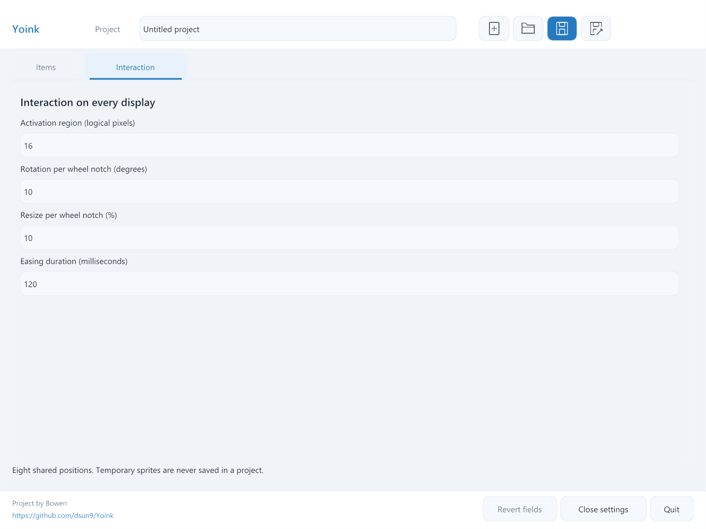
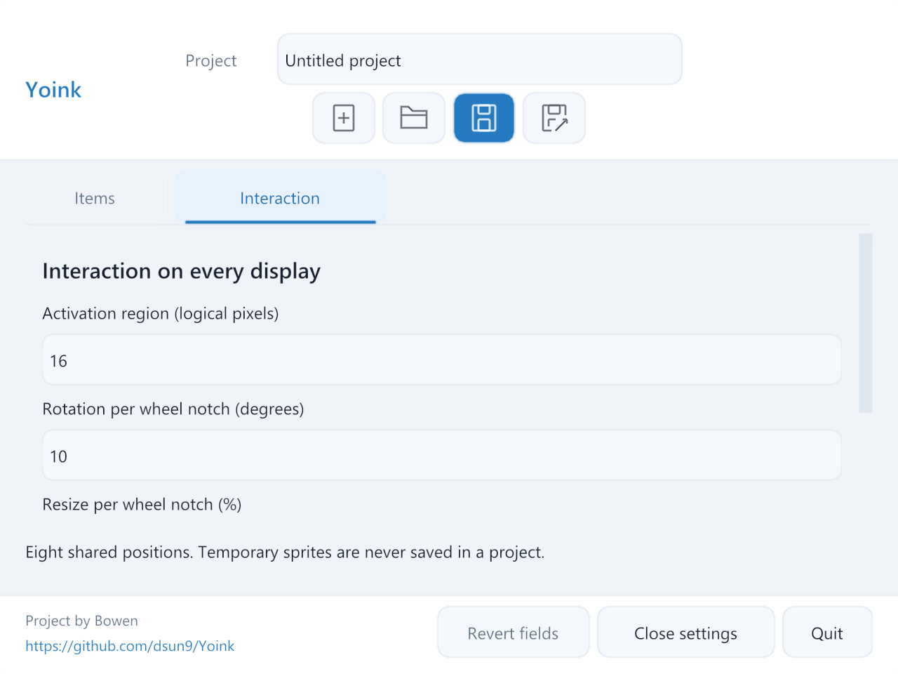
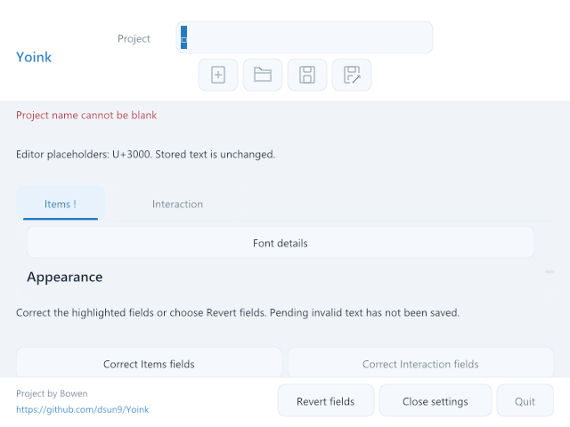

# PR #28 Settings layout correction

Verified on Windows on 2026-10-13 against the native SDL3/OpenGL/Nuklear renderer.

The Project label, editable name, dirty marker and four project actions now form
one centered group with vertical padding. Narrow windows center the wrapped
action row below the name. Items and Interaction use compact tabs with a shared
baseline and a blue selected edge. The footer groups Revert fields, Close
settings and Quit on the right, and credits Project by Bowen with the complete
`https://github.com/dsun9/Yoink` link on the left.

## Reproduction and verification

`pointy_settings_smoke.exe --chrome-only` uses actual controls, input and rendered
pixels. Before the correction it failed with project-name y=12, tab widths
499/499 and footer button widths 331/330/331 at 1040 by 780. Afterward it passes
centering, padding, tab appearance, keyboard switching, complete URL text and
footer separation at 1040 by 780, 640 by 480, 700 by 600 and 1600 by 900, with
controlled 100%, 150% and 200% UI scales. Project-name roundtrips, batched tab
edits, suspended editor input, scrolling and the existing responsive checks are
also included in this focused command.

The independent review identified a minimum-size case combining an invalid
item size, an invalid project name containing U+3000, and its Unicode placeholder
notice. The new real-input case first failed with footer bottom=486 against
visible bottom=468. It now passes on both tabs at all three scales, keeps every
footer control within the viewport, and activates Revert fields to recover.
The focus-scrolling check first failed when the invalid Size field moved from
y=268 to y=278 between frames. It now stays at y=275 over eight repeated draws.

Header messages now consume scrolling-content space before footer space.
Focus-reveal margins shrink when the available viewport cannot fit the normal
margins, preventing alternating scroll positions.

The final Windows Debug app and affected test targets build without compiler
warnings or errors. The complete hidden Settings command, `--render-only`,
passes in 227.81 seconds on the final code. It includes the existing editor,
thumbnail, project-name, save/open, corrected-draft, reorder, modal, popup,
composition, retained-draft and responsive cases, plus the new layout checks.
The focused `--validation-only` command also passes.

`ctest --preset windows-dev -R '^(drawer_hidden|ui_events)$' --output-on-failure`
passes 2/2 in 19.27 seconds. The drawer check covers the other user of the shared
focus-reveal helper. The independent review confirmed both reported edge cases
resolved, with no remaining blocking findings.

## Captures

These are actual native-renderer captures, without synthesized OS input or
foreground activation.

The controlled scales do not establish physical monitor transitions or macOS
runtime behavior.
